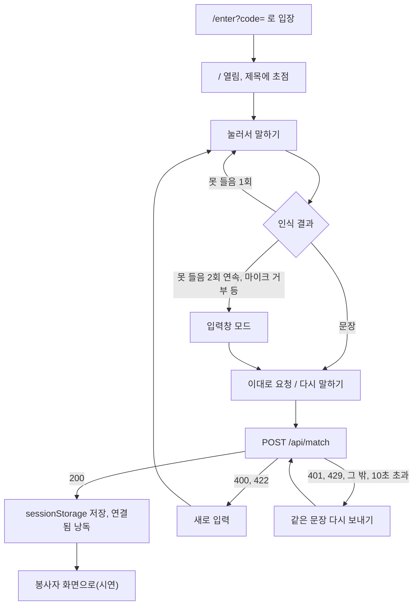
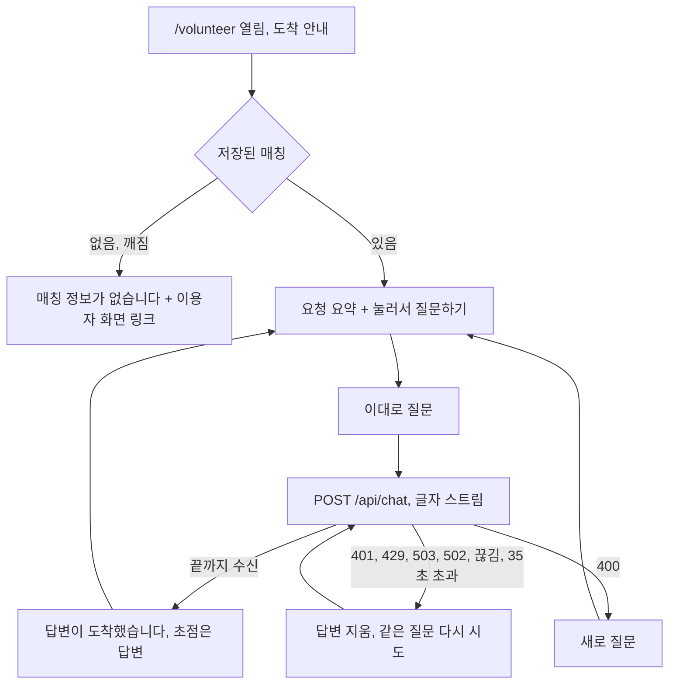

초안. 코드 기준 커밋 870c13c. 앱 동작의 근거는 코드이고 사람 검토 전이다.

# 09 사용자 플로우

근거 표기는 `apps/web/` 기준 `파일:줄`이다. 화면 시험은 가짜 음성 입력 기준이다. 실제 아이폰, VoiceOver, 실제 음성 인식 동작은 AI가 확인하지 못했다. 낭독 문구 원문과 초점은 08-screens.md, 서버 오류 코드는 07-components.md에 있다.

두 플로우는 한 사람이 같은 탭에서 이어 가는 시연 흐름이다. 실제 제품처럼 이용자와 봉사자가 따로 접속하는 흐름은 아직 코드에 없다(아래 "아직 없음").

## 1. 이용자 플로우: 음성 요청 → 확인 → 매칭 → 시연 이어 보기

### 정상 경로

1. 시연 주소로 `GET /enter?code=...`를 열면 접근 쿠키가 생기고 `/`로 이동한다(303)(enter/route.ts:30-43).
2. `/`가 열리고 초점이 제목 "LightHouse 상품 요청"에 놓인다(page.tsx:22-24).
3. "눌러서 말하기"를 누른다. 약 1초 뒤 인식이 시작되고(speech.ts:11, 289-290) "듣고 있습니다. 말씀하세요."가 나온다(speech.ts:20).
4. 이용자가 말한다. 인식이 끝나면 "이렇게 들었습니다: {문장}"이 나오고 초점이 "이대로 요청"으로 간다(speech.ts:117, SpeechInput.tsx:68-71). 문장이 틀렸으면 "다시 말하기"를 누른다(SpeechInput.tsx:142-153).
5. "이대로 요청"을 누르면 "봉사자를 찾고 있습니다."가 나오고 `POST /api/match`가 나간다(speech.ts:127-134, page.tsx:26-28).
6. 서버는 접근 쿠키와 횟수를 확인하고, 문장에서 브랜드·품목을 찾고(소니·sony → Sony, 헤드셋·헤드폰 → 헤드셋), 품목에 맞는 가상 봉사자를 정해 돌려준다(match/route.ts:39-65, parseRequest.ts:4-5, volunteers.ts:15-17).
7. 브라우저가 응답을 `sessionStorage`의 `lh.match.v1`에 저장한다(page.tsx:31, matchHandoff.ts:70-76). 이것이 시연 예외다. 실제 제품의 전달 경로가 아니다.
8. "{봉사자 이름}와 연결됐습니다."가 나오고 말하기 부품이 사라지며 버튼 "봉사자 화면으로(시연)"에 초점이 간다(page.tsx:32-35, 52-54, DemoHandoff.tsx:11-13).
9. 그 버튼을 누르면 같은 탭에서 `/volunteer`로 이동한다(DemoHandoff.tsx:20).

### 실패 경로

1. 못 들음 1회: "못 들었습니다. 버튼을 눌러 다시 말씀하세요."가 나오고 처음 상태로 돌아간다. 연속 2회면 입력창 모드가 되고 "음성 인식을 쓸 수 없습니다. 입력창에 받아쓰기로 입력하세요."와 함께 초점이 입력창으로 간다(speech.ts:17, 119-124, 171-173, SpeechInput.tsx:73-76). 인식에 성공하면 연속 횟수는 0으로 돌아간다(speech.ts:116).
2. 마이크 거부, 오디오 장치 없음, 인식 서비스 오류, 시작 신호가 3초 안에 없음, 이 브라우저에 음성 인식이 없음: 바로 입력창 모드로 간다(speech.ts:13, 40-46, 280-286, SpeechInput.tsx:63-66).
3. 듣기를 시작한 뒤 15초 안에 끝나지 않으면 끊고 들은 것이 있으면 결과로, 없으면 못 들음으로 처리한다(speech.ts:15, 246-248, 261).
4. 입력창에서 빈 채로 제출: "입력창에 찾는 상품을 입력하세요."가 나오고 서버로 보내지 않는다(SpeechInput.tsx:109-115).
5. 품목을 못 알아들음(422): "찾는 상품을 알아듣지 못했습니다. 상품 이름을 넣어 다시 요청하세요."가 나오고 새로 입력하는 곳으로 초점이 간다. 지금 알아듣는 품목은 "헤드셋·헤드폰"뿐이다(match/route.ts:54-55, speech.ts:27, 153-160, parseRequest.ts:5).
6. 문장이 200자를 넘음(400): "요청이 너무 깁니다. 짧게 다시 요청하세요."(match/route.ts:12, 52, matchHandoff.ts:38-39).
7. 접근 쿠키 없음(401): "접근 코드가 필요합니다. 시연 주소로 다시 열어 주세요."가 나오고 같은 문장을 다시 보낼 수 있다(matchHandoff.ts:42-43, speech.ts:161-167).
8. 요청이 분당 30회를 넘음(429): "요청이 많습니다. 1분 뒤 다시 시도해 주세요."(match/route.ts:15, 43-48, matchHandoff.ts:44-45).
9. 서버 오류(500), 네트워크 끊김, 10초 안에 응답 없음, 응답 형식 오류: "봉사자 연결에 실패했습니다. 다시 시도해 주세요."가 나오고 같은 문장을 다시 보낼 수 있다. 음성 요청이면 "이대로 요청"으로, 입력창 요청이면 제출 버튼으로 초점이 간다(matchHandoff.ts:8, 46-47, 61-66, SpeechInput.tsx:83-85).
10. 이어 보기 저장이 막힌 브라우저: 이용자 화면은 그대로 "연결됐습니다"까지 가고, 봉사자 화면이 "매칭 정보가 없습니다."를 보인다(matchHandoff.ts:69-76, volunteer/page.tsx:63).

## 2. 봉사자 플로우: 요청 확인 → 음성/입력 질문 → AI 답변 → 다시 질문

### 정상 경로

1. `/volunteer`가 열리고 초점이 제목 "봉사자 화면(시연)"에 놓인다. 약 0.1초 뒤 낭독 영역에 "시연: 봉사자 화면으로 바뀌었습니다. 이용자 요청: {요청}."이 채워진다(volunteer/page.tsx:25-29, 52-63).
2. 화면에 이용자 요청, 이용자가 한 말, 연결된 봉사자 이름이 나온다(volunteer/page.tsx:77-84).
3. "눌러서 질문하기"를 누르고 말한다. 입력 부품 동작은 이용자 플로우 3~4단계와 같고 버튼 이름만 다르다: "이대로 질문", "다시 말하기"(VolunteerChat.tsx:13-19).
4. "이대로 질문"을 누르면 "답변을 만들고 있습니다."가 나오고 이전 답변이 지워진다. `POST /api/chat`에 `requestId`, 질문, 브랜드·품목이 간다(VolunteerChat.tsx:40-51, chat.ts:60-65).
5. 서버는 접근 쿠키, 횟수(분당 20회), 본문 크기(2048바이트)와 질문 길이(300자), 챗봇 설정을 차례로 확인하고 Groq(모델 `openai/gpt-oss-120b`)에 질문 한 개와 지시문만 보낸다(chat/route.ts:100-125, llm.ts:9, 61-70).
6. 답변 글자가 오는 대로 답변 영역에 이어 붙는다. 이때 낭독 영역은 바뀌지 않는다(VolunteerChat.tsx:48-50, 79).
7. 스트림이 끝나면 "답변이 도착했습니다."가 나오고 초점이 답변 영역으로 가서 답변을 읽게 한다(VolunteerChat.tsx:54-57, 36-38, speech.ts:34). 답이 길어 잘렸으면 끝에 "답변이 길어 일부가 잘렸습니다."가 붙는다(llm.ts:86).
8. 입력 부품이 처음 상태("눌러서 질문하기")로 돌아가 다시 질문할 수 있다. 새 질문을 보내면 이전 답변은 지워진다. 대화 기록은 서버에 보내지 않으므로 앞 질문을 이어서 묻는 구조가 아니다(speech.ts:137-145, VolunteerChat.tsx:42, llm.ts:66-69).

### 실패 경로

1. 저장된 매칭이 없거나 깨졌음(다른 탭·기기에서 열기, 저장소 차단 등): "매칭 정보가 없습니다."와 링크 "이용자 화면으로 돌아가기"만 나온다. 질문 부품은 그리지 않는다(volunteer/page.tsx:75, 92, matchHandoff.ts:86-96, tests/e2e/match.spec.ts:299-322).
2. 듣기·입력 단계의 실패(못 들음, 마이크 거부, 빈 질문)는 이용자 플로우 실패 1~4와 같다. 빈 질문 문구는 "입력창에 질문을 입력하세요."다(speech.ts:32).
3. 질문이 300자를 넘거나 본문이 2048바이트를 넘음(400): "질문이 너무 깁니다. 짧게 다시 말해 주세요."가 나오고 새로 질문하는 곳으로 초점이 간다(chat/route.ts:49-58, chat.ts:36-37, VolunteerChat.tsx:58-61). 형식이 잘못된 요청도 같은 문구가 나온다(chat.ts:36-37).
4. 접근 쿠키 없음(401), 요청 과다(429), 챗봇 설정 안 됨(503): 각각 "접근 코드가 필요합니다. 시연 주소로 다시 열어 주세요.", "요청이 많습니다. 1분 뒤 다시 시도해 주세요.", "챗봇 설정이 끝나지 않았습니다."가 나오고 답변 영역을 비운다. 같은 질문을 다시 보낼 수 있다(chat.ts:38-43, VolunteerChat.tsx:62-65).
5. Groq 오류(502), 글자 없이 끝남, 네트워크 끊김, 답변 도중 끊김, 35초 초과: "답변 서버에 연결하지 못했습니다. 다시 시도해 주세요."가 나온다. 도중에 끊기면 이미 받은 글자도 지운다(chat/route.ts:127-135, chat.ts:8, 49-52, 81-85, VolunteerChat.tsx:62-65).
6. 다시 시도: 확인 버튼 이름이 "다시 시도"로 바뀌고 초점이 그리로 간다. 음성 질문이면 "다시 말하기"도 남아 있다(VolunteerChat.tsx:16, SpeechInput.tsx:60-61, 83-85).
7. 화면을 떠나면 진행 중인 요청이 취소된다(VolunteerChat.tsx:33).

## 3. 아직 없음 (코드에서 확인한 사실)

- 이용자와 봉사자가 서로 다른 기기에서 만나는 흐름: 없다. 봉사자 화면은 이용자가 같은 탭에 저장한 값(`lh.match.v1`)을 읽는다. 시연 예외다(matchHandoff.ts:1-2, 70-76, docs/TSD.md:208).
- 봉사자 대기열, 수락·거절, 이용자에게 가는 알림: 없다. 봉사자는 고정 명단에서 정한다(volunteers.ts:9-17).
- 로그인: 없다. 공통 접근 코드뿐이다(access.ts:4-5).
- 봉사자가 찾은 결과를 이용자에게 전하는 화면: 없다. AI는 "찾는 방법"만 답하도록 지시문에 쓰여 있다(prompt.ts:8-10).
- 주의: AI 답변의 품질 규칙(가격·재고 금지 등)은 지시문에 쓰여 있을 뿐, 실행 중에 걸러내지 않는다. 검사는 고정 질문 시험에서 한다(prompt.ts:17-20, .claude/rules/chatbot-quality.md).
